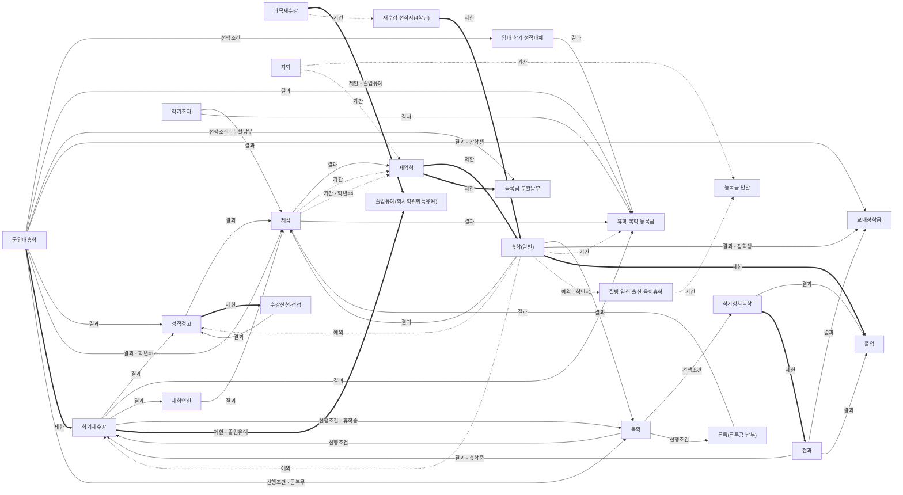

# 물어보기 — 규정 그래프 검토표

`tools/rule-graph/review_sheet.py` 가 `rule-graph.json`(version 2026-10-31.1)에서 만든다. 손으로 고치지 않는다.
설계: [`ask-rule-graph-plan.md`](ask-rule-graph-plan.md). 점 24개, 선 49개 — **확인됨 0 / 확인 전 49**.

## 검토하는 법

1. 아래 표에서 선마다 **사실** 이 **근거 원문** 과 맞는지, 학생에게 그대로 말해도 되는지 본다.
2. 맞으면 `rule-graph.json` 의 그 선 `reviewed` 에 `"YYYY-MM-DD 이름"` 을 적는다. 고칠 게 있으면 `fact`·`condition` 을 고치고 적는다. 틀리면 선을 지운다.
3. `python3 -I tools/rule-graph/validate.py` 로 검사하고, 이 스크립트로 표를 다시 만든다.

서버는 `reviewed` 가 있는 선만 쓴다. 확인 전 선은 켜도 쓰이지 않는다.

## 연결 그림

실선 = 결과·선행조건, 굵은 선 = 제한, 점선 = 예외·기간. 선 이름 뒤 ✅ 는 확인된 선.

## 선별 검토

### 학기재수강

| 확인 | 선 | 종류 | 조건 | 사실(답 쓰기에 들어가는 문장) | 근거 원문 |
|---|---|---|---|---|---|
| ☐ | `retake-keeps-warning` 학기재수강 → 성적경고 | 결과 |  | 학기재수강으로 학기를 지워도 그 학기에 받은 성적경고 기록은 그대로 남는다. | `faq-retake/semester-retake-after` “성적경고를 받은 학기를 지워도 성적경고 기록은 그대로 남아요.” |
| ☐ | `retake-extends-study` 학기재수강 → 휴학·복학 등록금 | 결과 |  | 학기재수강으로 지운 학기를 빼고 8학기(5년제 10학기)를 채워야 해서 졸업이 늦어지고 등록금을 더 낼 수 있다. | `faq-retake/semester-retake-after` “지운 학기를 빼고 수업연한을 채워야 해서 등록금을 더 낼 수 있어요.” |
| ☐ | `retake-counts-residency` 학기재수강 → 재학연한 | 결과 |  | 학기재수강으로 지운 학기도 재학연한에 들어간다. | `faq-retake/semester-retake-after` “지운 학기도 재학연한에 들어가요.” |
| ☐ | `retake-after-return` 학기재수강 → 복학 | 선행조건 | 휴학중 | 휴학생은 복학 신청이 승인된 뒤 학기재수강을 신청하고, 직전 한 학기만 지우면 복학 신청 때 함께 고른다. | `faq-retake/semester-retake-apply` “복학 예정자는 복학 신청이 승인된 뒤에 신청할 수 있어요.” |
| ☐ | `deferral-no-semester-retake` 학기재수강 → 졸업유예(학사학위취득유예) | 제한 | 졸업유예 | 졸업유예(학사학위취득유예) 중에는 학기재수강을 신청할 수 없다. | `faq-retake/semester-retake-apply` “학사학위취득유예자는 학기재수강을 신청할 수 없어요.” |

### 성적경고

| 확인 | 선 | 종류 | 조건 | 사실(답 쓰기에 들어가는 문장) | 근거 원문 |
|---|---|---|---|---|---|
| ☐ | `warning-3-expel` 성적경고 → 제적 | 결과 |  | 성적경고를 연속 3개 학기 받으면 당연 제적된다. | `warning/start` “연속으로 3개 학기를 성적경고 받은 경우 당연 제적된다.” |
| ☐ | `warning-no-carryover` 성적경고 → 수강신청·정정 | 제한 |  | 직전 학기가 성적경고면 다음 학기 학점 이월이 안 된다. | `faq-registration/credit-rules` “직전 학기가 학사경고(성적경고)면 이월이 안 돼요.” |

### 휴학(일반)

| 확인 | 선 | 종류 | 조건 | 사실(답 쓰기에 들어가는 문장) | 근거 원문 |
|---|---|---|---|---|---|
| ☐ | `leave-keeps-warning-streak` 휴학(일반) → 성적경고 | 예외 |  | 사이에 휴학한 학기는 성적경고 연속을 끊지 않는다. | `warning/start` “사이에 휴학한 학기는 연속을 끊지 않고” |
| ☐ | `leave-no-auto-return` 휴학(일반) → 복학 | 결과 |  | 휴학이 끝나도 저절로 복학·휴학연장이 되지 않아 기간 안에 직접 신청해야 한다. | `faq-leave/leave-extend-missed` “휴학이 끝나도 저절로 복학이나 휴학 연장이 되지 않아요.” |
| ☐ | `leave-no-return-expel` 휴학(일반) → 제적 | 결과 |  | 휴학 기간이 끝났는데 복학·휴학연장을 신청하지 않으면 미복학 제적된다. | `expulsion/start` “휴학기간 경과 후 복학신청기간에 복학 또는 휴학연장신청을 하지 않은 학생은 미복학 제적됩니다.” |
| ☐ | `leave-scholarship-lost` 휴학(일반) → 교내장학금 | 결과 | 장학생 | 학비 감면 장학생이 등록금을 내지 않고 휴학하면 그 장학금이 없어지고 복학 때 감면 없는 전액을 낸다. | `faq-leave/leave-tuition-scholarship` “학비 감면 장학생(홍익인간·자주·창조·협동·정진·한마음·면학)이 안 내고 휴학하면 그 장학금은 없어지고, 복학할 때 감면 없는 전액을 내요.” |
| ☐ | `leave-late-tuition` 휴학(일반) → 휴학·복학 등록금 | 기간 |  | 수업일수 절반이 지난 뒤 일반휴학하면 복학 학기에 등록금을 전액 다시 낸다. | `leave-of-absence/tuition` “수업일수의 절반이 지난 뒤 일반휴학하면 복학 학기에 등록금을 전액 다시 내야 해요.” |
| ☐ | `leave-blocks-graduation` 휴학(일반) → 졸업 | 제한 |  | 졸업 예정 학기에 휴학하면 그 시기에 졸업할 수 없다(졸업은 재학 상태에서만 된다). | `faq-leave/leave-extend-missed` “졸업 예정 학기에 휴학하면 그 시기에 졸업할 수 없어요.” |
| ☐ | `leave-cancels-retake` 휴학(일반) → 학기재수강 | 예외 |  | 학기재수강을 신청한 학기에 휴학·제적 같은 학적 변동이 생기면 학기재수강 신청이 직권 취소된다. | `faq-retake/semester-retake-after` “신청한 학기에 휴학·제적 같은 학적 변동이 생기면 학기재수강 신청이 직권 취소돼요.” |
| ☐ | `freshman-no-general-leave` 휴학(일반) → 질병·임신·출산·육아휴학 | 예외 | 학년=1 | 신입생은 입학 후 1년간 일반휴학을 할 수 없고, 군입대·질병휴학만 증빙서류로 할 수 있다. | `leave-of-absence/general` “신입생은 입학 후 1년간(1학년 1·2학기) 일반휴학을 신청할 수 없어요.” |

### 제적

| 확인 | 선 | 종류 | 조건 | 사실(답 쓰기에 들어가는 문장) | 근거 원문 |
|---|---|---|---|---|---|
| ☐ | `expel-readmit-limit` 제적 → 재입학 | 결과 |  | 제적·자퇴한 뒤 돌아오려면 재입학을 신청해야 하고, 재입학은 2회까지만 허가된다. | `readmission/start` “재입학은 2회에 한하여 허가하며” |
| ☐ | `expel-readmit-wait` 제적 → 재입학 | 기간 |  | 제적된 학기 시작일부터 두 학기(성적경고 제적은 2년)가 지나야 재입학을 신청할 수 있다. | `readmission/start` “재입학은 제적된 날이 속한 학기의 학기개시일로부터 두개 학기(학칙 제31조 제7호의 성적경고 제적자는 2년) 이내에 신청할 수 없습니다.” |
| ☐ | `expel-readmit-wait-senior` 제적 → 재입학 | 기간 | 학년=4 | 4학년은 제적 사유와 관계없이 한 학기가 지나면 재입학을 신청할 수 있다. | `readmission/start` “단, 4학년의 경우 제적 사유와 관계없이 1학기 경과 후 재입학 신청이 가능합니다.” |
| ☐ | `expel-paid-refund` 제적 → 휴학·복학 등록금 | 결과 |  | 휴학 때 낸 등록금은 미복학·자퇴로 제적되면 서류를 내고 돌려받을 수 있다. | `leave-of-absence/tuition` “휴학 때 등록금을 냈는데 미복학·자퇴로 제적되면? → 돌려받을 수 있어요.” |

### 재입학

| 확인 | 선 | 종류 | 조건 | 사실(답 쓰기에 들어가는 문장) | 근거 원문 |
|---|---|---|---|---|---|
| ☐ | `readmit-no-leave` 재입학 → 휴학(일반) | 제한 |  | 재입학한 학기에는 질병·군입대가 아니면 휴학할 수 없다. | `readmission/start` “재입학자는 합격한 당해 학기에 질병 또는 군입대 사유를 제외하고는 휴학할 수 없습니다.” |
| ☐ | `readmit-no-installment` 재입학 → 등록금 분할납부 | 제한 |  | 재입학 합격자는 등록금 납부연기·분할납부를 할 수 없고, 등록금을 안 내면 제적된다. | `readmission/start` “납부연기 또는 분할납부는 불가하며, 합격 후 등록금 미납 시 제적 처리됩니다.” |

### 질병·임신·출산·육아휴학

| 확인 | 선 | 종류 | 조건 | 사실(답 쓰기에 들어가는 문장) | 근거 원문 |
|---|---|---|---|---|---|
| ☐ | `sick-leave-refund` 질병·임신·출산·육아휴학 → 등록금 반환 | 기간 |  | 질병·임신·출산·육아휴학은 낸 등록금을 휴학원서 최종 제출일 기준으로 돌려받고, 복학 학기에 전액 다시 낸다. | `leave-of-absence/tuition` “낸 등록금은 '대학 등록금에 관한 규칙'에 따라 돌려받고, 복학 학기에 전액 다시 내요.” |

### 재학연한

| 확인 | 선 | 종류 | 조건 | 사실(답 쓰기에 들어가는 문장) | 근거 원문 |
|---|---|---|---|---|---|
| ☐ | `residency-expel` 재학연한 → 제적 | 결과 |  | 재학연한 안에 졸업 요건을 모두 갖추지 못하면 재학연한 제적된다. | `expulsion/start` “재학연한 내에 졸업에 필요한 요건을 모두 충족하지 않은 학생은 재학연한 제적됩니다.” |

### 과목재수강

| 확인 | 선 | 종류 | 조건 | 사실(답 쓰기에 들어가는 문장) | 근거 원문 |
|---|---|---|---|---|---|
| ☐ | `deferral-no-course-retake` 과목재수강 → 졸업유예(학사학위취득유예) | 제한 | 졸업유예 | 졸업유예생은 신규 교과목만 들을 수 있고 과목재수강은 안 된다. | `faq-registration/excess-semester-registration` “학사학위취득유예(졸업유예)생은 신규 교과목만 들을 수 있고 재수강은 안 돼요.” |
| ☐ | `retake-delete-timing` 과목재수강 → 재수강 선삭제(4학년) | 기간 |  | 재수강 전 성적은 그 학기 성적이 확정된 뒤 지워지고, 4학년은 선삭제를 신청해 미리 지울 수 있다. | `course-retake/start` “종강일 이후 재수강 학기의 성적이 확정되는 시점에 삭제됨 (단, 4학년 학생인 경우 선삭제 신청이 가능함)” |

### 재수강 선삭제(4학년)

| 확인 | 선 | 종류 | 조건 | 사실(답 쓰기에 들어가는 문장) | 근거 원문 |
|---|---|---|---|---|---|
| ☐ | `predelete-locks-status` 재수강 선삭제(4학년) → 휴학(일반) | 제한 |  | 재수강 선삭제가 승인되면 그 학기에 수강신청 삭제나 휴학·제적 같은 학적변동을 할 수 없다. | `retake-predelete/start` “과목재수강 선 삭제 신청하여 승인된 이후 수강신청을 삭제하거나 추가로 학적변동(휴학 또는 제적)은 불가능합니다.” |

### 군입대휴학

| 확인 | 선 | 종류 | 조건 | 사실(답 쓰기에 들어가는 문장) | 근거 원문 |
|---|---|---|---|---|---|
| ☐ | `military-grade-substitute` 군입대휴학 → 입대 학기 성적대체 | 선행조건 |  | 학기 절반이 지난 뒤 종강 전에 입대하면서 그 학기 성적을 인정받으려면 성적대체를 신청해야 한다. | `military-leave/start` “학기 개시 1/2 이후~종강일 이전 군입대하는 학생 중, 해당 학기 성적을 인정받기를 희망할 경우, 성적대체 신청해야 함” |
| ☐ | `military-tuition-carry` 군입대휴학 → 휴학·복학 등록금 | 결과 |  | 학기 중(종강 전) 군입대휴학을 하면 낸 등록금이 복학 학기로 넘어가 복학 때 등록금이 나오지 않는다(성적대체를 하지 않은 경우). | `military-leave/start` “학기 중(종강 전) 군입대휴학을 하는 학생의 등록금은 복학하는 학기로 이연처리되며 복학학기에는 등록금이 부과되지 않음” |
| ☐ | `military-installment` 군입대휴학 → 등록금 분할납부 | 선행조건 | 분할납부 | 분할납부 중에 군입대휴학을 하려면 남은 분할금을 다 내거나, 낸 금액을 돌려받고 등록을 취소해야 한다(클래스넷 신청 불가). | `installment/start` “등록금 분납신청자가 군 휴학할 경우 미납된 분할등록금을 완납하거나 이미 납부한 분할등록금을 반환받고 등록을 취소하여야 하며” |
| ☐ | `military-scholarship` 군입대휴학 → 교내장학금 | 결과 | 장학생 | 장학생이 군입대휴학하면 등록기간에 등록금을 내야 장학금이 복학 학기로 넘어가고, 내지 않으면 장학금이 삭제된다. | `military-leave/start` “단, 장학금 수혜대상자가 등록금을 미납할 경우 장학금이 삭제됨.” |
| ☐ | `military-no-leave-warning` 군입대휴학 → 성적경고 | 결과 |  | 군휴학을 신청하지 않고 입대하면 재학생으로 남아 등록금 이연이 안 되고 성적경고 같은 불이익을 받을 수 있다(소급 신청 필요). | `faq-leave/leave-freshman-military` “재학생으로 남아 등록금 이연 불가, 성적경고 같은 불이익을 받을 수 있어요.” |
| ☐ | `military-freshman-unpaid` 군입대휴학 → 제적 | 결과 | 학년=1 | 1학년이 등록금을 내지 않은 채 학기 중 군입대휴학하면 미등록제적될 수 있고 수강신청 내역은 모두 지워진다. | `faq-leave/leave-freshman-military` “이때 등록금을 안 냈으면 미등록제적될 수 있고, 수강신청 내역은 모두 지워져요.” |
| ☐ | `military-retake-offline` 군입대휴학 → 학기재수강 | 제한 |  | 학기재수강이나 재수강 선삭제를 신청한 학기에 성적 없이 입대하면 클래스넷으로 군입대휴학을 신청할 수 없고 학적변동 담당자에게 문의해야 한다. | `military-leave/start` “군입대휴학을 신청하려는 학기에 ‘학기재수강’ 또는 ‘재수강 선삭제’를 신청했으나, 해당학기 성적을 취득하지 못한 채 학기 도중 군입대 하는 학생” |
| ☐ | `discharge-return-leave-days` 군입대휴학 → 복학 | 선행조건 | 군복무 | 개강 뒤 전역하면 개강일부터 전역일 전까지 평일을 잔여휴가로 모두 채울 수 있어야 그 학기에 복학할 수 있다. | `faq-leave/return-after-military` “개강일부터 전역일 전까지 모든 평일을 잔여휴가로 채워야 해요.” |

### 입대 학기 성적대체

| 확인 | 선 | 종류 | 조건 | 사실(답 쓰기에 들어가는 문장) | 근거 원문 |
|---|---|---|---|---|---|
| ☐ | `military-grade-tuition` 입대 학기 성적대체 → 휴학·복학 등록금 | 결과 |  | 성적대체로 입대 학기 성적을 인정받으면 등록금이 그 학기 것으로 처리돼 복학 학기에 등록금을 다시 낸다. | `tuition-refund/faq0` “이 경우 휴학학기의 성적이 인정되며 휴학학기의 등록금으로 처리됩니다.” |

### 복학

| 확인 | 선 | 종류 | 조건 | 사실(답 쓰기에 들어가는 문장) | 근거 원문 |
|---|---|---|---|---|---|
| ☐ | `odd-leave-choice-retake` 복학 → 학기재수강 | 선행조건 |  | 홀수 학기(1학기, 3학기 등)를 휴학하고 복학하면 학기재수강(직전 학기 성적 삭제)과 학기상치복학 중 하나를 골라야 한다. | `return/faq0` “홀수 단위(1학기, 3학기 등)로 휴학을 하고 복학신청을 하는 경우 학기재수강 또는 학기상치복학을 선택해야 하며, 이때 학기재수강을 선택하는 경우 휴학직전학기의 성적이 삭제됩니다.” |
| ☐ | `odd-leave-choice-early` 복학 → 학기상치복학 | 선행조건 |  | 홀수 학기를 휴학하고 복학하면 학기상치복학(한 학기 건너 상급 학기로)과 학기재수강 중 하나를 골라야 한다. | `return/faq0` “홀수 단위(1학기, 3학기 등)로 휴학을 하고 복학신청을 하는 경우 학기재수강 또는 학기상치복학을 선택해야 하며, 이때 학기재수강을 선택하는 경우 휴학직전학기의 성적이 삭제됩니다.” |
| ☐ | `return-unpaid-expel` 복학 → 등록(등록금 납부) | 선행조건 |  | 휴학 신청을 취소하고 복학할 때 등록금을 안 냈으면 추가 등록기간에 꼭 내야 하고, 안 내면 미등록제적된다. | `faq-leave/leave-cancel-change` “등록금을 안 냈으면 추가 등록기간(2026-2학기 기준 9.11~9.16)에 꼭 내요. 안 내면 미등록제적돼요.” |

### 학기상치복학

| 확인 | 선 | 종류 | 조건 | 사실(답 쓰기에 들어가는 문장) | 근거 원문 |
|---|---|---|---|---|---|
| ☐ | `early-return-required-courses` 학기상치복학 → 졸업 | 결과 |  | 학기상치복학으로 건너뛴 학기의 필수과목은 재학 중 반드시 따야 하고, 8학기를 채우려면 한 학기를 더 다닌다. | `return/start` “이때 뛰어넘은 2학년 1학기 필수교과목은 재학 중 반드시 학점을 취득해야 합니다.” |
| ☐ | `early-return-no-transfer` 학기상치복학 → 전과 | 제한 |  | 한 학기만 휴학하고 학기상치복학하면 학년별 수료요건을 못 채워 전과에 지원할 수 없다. | `change-major/faq0` “1개 학기만 휴학하고 상치복학을 하는 학생은 학년별 수료요건을 충족하지 못하므로 전과지원이 불가함에 유의하시기 바랍니다.” |

### 전과

| 확인 | 선 | 종류 | 조건 | 사실(답 쓰기에 들어가는 문장) | 근거 원문 |
|---|---|---|---|---|---|
| ☐ | `transfer-semester-retake` 전과 → 학기재수강 | 결과 | 휴학중 | 3학기·5학기를 마치고 휴학 중 전과에 합격하면 전과 전에 들은 그 학년 1학기 성적이 학기재수강으로 처리된다. | `change-major/start` “2학년 전과 합격자는 전과 전 이수한 2학년 1학기 성적이, 3학년 전과 합격자는 전과 전 이수한 3학년 1학기 성적이 학기재수강으로 처리됨” |
| ☐ | `transfer-scholarship` 전과 → 교내장학금 | 결과 |  | 전과 합격자는 전과가 허가된 학기에 교내장학금 7종 대상에서 빠진다. | `change-major/start` “전과 전형 합격자는 전과가 허가된 당해 학기 교내장학금 7종(홍익인간, 자주, 창조, 협동, 정진, 한마음, 면학)의 수혜대상자에서 제외됩니다.” |
| ☐ | `transfer-old-major-credits` 전과 → 졸업 | 결과 |  | 전과하면 이전 학과 전공 과목은 일반선택으로 바뀌어 졸업학점에 들어간다. | `change-major/start` “전출학과의 전공(기초/필수/선택) 교과목과 학점은 일반선택으로 전환되어 졸업학점에 포함됩니다.” |

### 자퇴

| 확인 | 선 | 종류 | 조건 | 사실(답 쓰기에 들어가는 문장) | 근거 원문 |
|---|---|---|---|---|---|
| ☐ | `dropout-refund` 자퇴 → 등록금 반환 | 기간 |  | 자퇴하면 자퇴원서 최종 제출일 기준으로 등록금을 돌려받는다(학기 시작 전 전액, 30일까지 5/6, 60일까지 2/3, 90일까지 1/2, 그 뒤 없음). | `dropout/faq0` “31일부터 60일까지 : 등록금의 2/3” |
| ☐ | `dropout-readmit-wait` 자퇴 → 재입학 | 기간 |  | 자퇴한 뒤 다시 다니려면 재입학을 신청해야 하고, 1년(두 학기)이 지나야 신청할 수 있다. | `readmission/start` “자퇴/미등록/미복학제적의 경우 : 2025학년도 1학기 제적 → (+1년) → 2026학년도 1학기 재입학부터 신청 가능” |

### 등록(등록금 납부)

| 확인 | 선 | 종류 | 조건 | 사실(답 쓰기에 들어가는 문장) | 근거 원문 |
|---|---|---|---|---|---|
| ☐ | `unregistered-expel` 등록(등록금 납부) → 제적 | 결과 |  | 정해진 등록기간에 등록하지 않으면(장학금으로 0원이어도 등록 필요) 미등록 제적된다. | `expulsion/start` “매학년도 정해진 등록기간에 등록하지 않은 재학생은 미등록 제적됩니다.” |

### 수강신청·정정

| 확인 | 선 | 종류 | 조건 | 사실(답 쓰기에 들어가는 문장) | 근거 원문 |
|---|---|---|---|---|---|
| ☐ | `no-courses-warning` 수강신청·정정 → 성적경고 | 결과 |  | 등록금을 내고 수강신청을 하지 않으면 그 학기는 성적경고다. | `faq-registration/missed-registration` “등록금을 낸 학생이 수강신청을 하지 않으면 그 학기 성적경고예요.” |

### 학기초과

| 확인 | 선 | 종류 | 조건 | 사실(답 쓰기에 들어가는 문장) | 근거 원문 |
|---|---|---|---|---|---|
| ☐ | `excess-unregistered-expel` 학기초과 → 제적 | 결과 |  | 졸업학점이 모자란 학기초과자가 최소 1학점 수강신청·등록도, 휴학도 하지 않으면 미등록 제적된다. | `excess-semester/start` “졸업학점이 모자라면 최소 1학점은 신청하고 등록금을 내야 하고, 못 하면 휴학해야 해요. 둘 다 안 하면 미등록 제적돼요” |
| ☐ | `excess-tuition-by-credits` 학기초과 → 휴학·복학 등록금 | 결과 |  | 학기초과자는 수강신청 학점에 따라 등록금을 낸다(1~3학점 1/6, 4~6학점 1/3, 7~9학점 1/2, 10학점 이상 전액). | `excess-semester/start` “1학점 ~ 3학점까지 : 원 학과 등록금의 1/6 금액” |
